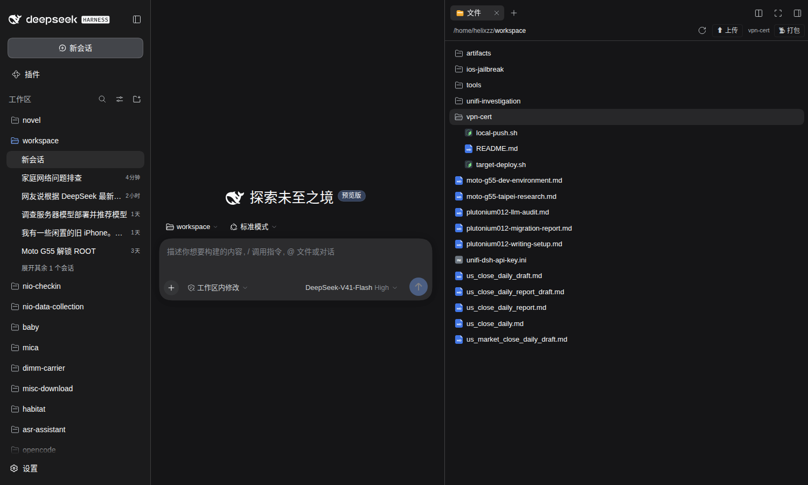
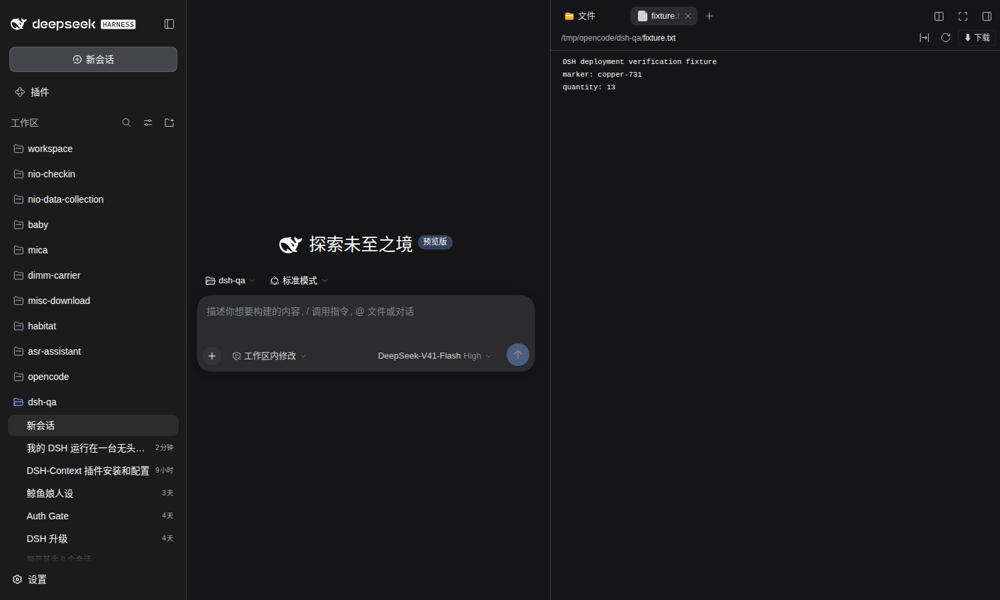

# dsh-file-transfer

[English](README.md) · [简体中文](README.zh.md) · [日本語](README.ja.md) · **한국어** · [Español](README.es.md) · [Русский](README.ru.md)

[](LICENSE)
[](https://github.com/deepseek-ai/deepseek-harness)
[](#development)

**DSH Web sidebar에서 파일을 내려받고, 원격 연결에서도 — localhost가 아니라도 — 파일을 다시 workspace로 업로드합니다.**

DeepSeek Harness에는 workspace를 둘러보고 미리 볼 수 있는 sidebar 파일 트리가 있지만, 양방향 모두 읽기 전용입니다. 이 plugin은 빠져 있던 두 가지 컨트롤을 추가합니다:

| | |
| --- | --- |
|  |  |
| 파일 트리 헤더의 **⬆ Upload** — 고른 파일을 workspace로 보냅니다 | 미리보기 헤더의 **⬇ Download** — 열려 있는 파일을 내 컴퓨터에 저장합니다 |

## 왜 만들었나

headless 장비에서 harness를 돌리고 브라우저로 접속한다면, 매일 쓰는 두 가지가 빠져 있습니다:

- **파일을 꺼낼 수 없습니다.** sidebar 어디에서도 `Content-Disposition`을 설정하지 않으므로, 미리 본 보고서나 PDF, 이미지를 저장할 방법이 없습니다. 결국 호스트로 돌아가 손으로 복사하게 됩니다 — `scp`, 공유 드라이브, USB 메모리.
- **파일을 넣을 수 없습니다.** workspace file 서비스는 `list` / `read` / `readBytes` / `stat` / `changes`만 노출하고 그 외에는 아무것도 없습니다. 쓰기 경로가 없으니, 노트북에 있는 파일은 agent가 건드리기 전에 다른 방법으로 먼저 업로드해야 합니다.

이 plugin은 의도적으로 작고 sidebar 안에 머뭅니다. 새로운 파일 브라우저를 만드는 것이 아니라, 이미 쓰고 있는 브라우저에 다운로드와 업로드 동작을 더합니다.

## 기능

**⬇ Download**

- 파일을 streaming합니다 — 바이트가 호스트 메모리에 하나의 버퍼로 통째로 올라가지 않습니다.
- `HEAD`와 단일 `Range`를 지원하므로 이어받기와 탐색이 동작합니다 (`206 Partial Content`).
- RFC 5987 `filename*`를 포함한 `Content-Disposition: attachment`를 사용하므로, CJK와 이모지 파일 이름이 `%E6%8A%A5...`로 도착하지 않고 그대로 왕복합니다.
- 확장자에 맞는 올바른 content type, 그리고 `nosniff`와 `no-store`.
- 자체적인 크기 상한은 없습니다.

**⬆ Upload**

- 원시 바이트를 디스크로 곧바로 streaming합니다: multipart 봉투도, base64도, 33% 부풀림도 없습니다.
- 먼저 `.dsh-part-*` 형제 파일에 쓰고 stream이 끝난 뒤에야 제자리로 rename하므로, 중단된 업로드가 실제 이름 아래 잘린 파일을 남기는 일이 없습니다.
- 절대 덮어쓰지 않습니다. 두 번째 `report.pdf`는 `report-1.pdf`가 됩니다.
- 선택적 크기 상한(`maxUploadBytes`)은 초과한 본문을 거부하고 뒷정리까지 합니다.

**공통**

- DSH 자체 Connection 계층에서 인증합니다 — 인증되지 않은 요청은 핸들러가 실행되기 전에 `401`로 거부됩니다. CSRF 토큰을 다룰 일도, 별도 로그인도 없습니다.
- 루트 allow-list, `realpath` 해석, symlink 탈출 거부.
- 익숙한 에러 봉투(`{ ok: false, error: { code, message } }`)와 안정적인 기계 판독용 코드.

## 설치

```sh
# from GitHub
dsh plugin --profile web add github:helixzz/dsh-file-transfer

# or from a local checkout
dsh plugin --profile web add /path/to/dsh-file-transfer
```

패키지가 `dsh.bundle.patch`를 선언하므로 `dsh plugin add`가 프로필의 `dsh.profile.bundles` 레이어 스택에 알아서 추가합니다 — `cordis.patch.yml`을 직접 편집할 필요가 없습니다.

그다음 프로필을 재시작하거나:

```sh
systemctl --user restart deepseek-harness.service   # or however you run dsh web
```

…또는 프로필이 `patchReload: live`로 동작한다면 로더가 새 번들을 집어가도록 두고 페이지를 새로고침하기만 하면 됩니다. (이 plugin이 처음 작성된 장비에서 배포되는 방식이 바로 이것입니다 — 재시작이 필요 없습니다.)

세션을 열고 오른쪽 sidebar를 펼친 뒤 **file** 탭을 고르세요. `⬆ Upload`는 새로고침 버튼 옆에 있습니다. 아무 파일이나 열면 `⬇ Download`가 "open with" 컨트롤 옆에 있습니다.

## 리버스 프록시 뒤에서

업로드에 맞는 body 크기 제한을 설정하세요. nginx라면:

```nginx
client_max_body_size 100m;
```

그 외에 필요한 것은 없습니다. 여기서 인증은 프록시의 일이 아닙니다. 라우트는 DSH의 Connection fetch registry에 등록되므로, 유효한 세션이 없는 요청은 plugin에 도달하지 않습니다:

```console
$ curl -o /dev/null -w '%{http_code}\n' \
    'http://127.0.0.1:3900/api/dsh-file-transfer/download?path=/etc/hostname'
401
```

## 설정

모든 옵션은 선택 사항입니다. 번들 패치를 편집하는 대신 자신의 프로필 레이어에서 덮어쓰세요:

```yaml
- id: file-transfer
  config:
    roots: []            # allow-list of absolute roots; [] means unrestricted
    allowUpload: true
    allowOverwrite: false
    maxUploadBytes: 0    # 0 means no limit
```

| 옵션 | 기본값 | 의미 |
| --- | --- | --- |
| `roots` | `[]` | 비어 있지 않으면 모든 다운로드·업로드 대상이 symlink까지 포함해 이 루트 중 하나 안으로 해석되어야 합니다. 그 외에는 `403 outside-roots`입니다. |
| `allowUpload` | `true` | `false`로 두면 업로드 라우트가 통째로 사라집니다 (`403 upload-disabled`). |
| `allowOverwrite` | `false` | 꺼져 있으면 기존 이름을 절대 대체하지 않고 비어 있는 `name-N.ext`를 사용합니다. |
| `maxUploadBytes` | `0` | 이보다 큰 본문은 `413 upload-too-large`로 거부하고 부분 파일을 삭제합니다. |

## HTTP API

두 개의 라우트가 있고 둘 다 `/api/` 아래에 있으며, 둘 다 인증된 Connection을 요구합니다. 터미널이나 스크립트, agent에서 유용합니다:

```sh
# download (streams to stdout; add -r 0-1023 for a range)
curl -O -J 'https://host/api/dsh-file-transfer/download?path=/abs/report.pdf'

# upload (raw bytes, no multipart envelope)
curl -X POST -H 'content-type: application/octet-stream' \
  --data-binary @report.pdf \
  'https://host/api/dsh-file-transfer/upload?dir=/abs/dir&name=report.pdf'
```

업로드가 성공하면 이렇게 응답합니다:

```json
{ "ok": true, "value": { "path": "/abs/dir/report.pdf", "name": "report.pdf", "bytes": 20481 } }
```

실패 시에는 harness의 나머지와 같은 봉투를 사용합니다:

```json
{ "ok": false, "error": { "code": "outside-roots", "message": "path is outside the configured roots" } }
```

| 코드 | 상태 | 의미 |
| --- | --- | --- |
| `missing-path` | 400 | `path` / `dir` 쿼리 파라미터가 없습니다. |
| `not-absolute` | 400 | 경로가 상대 경로였습니다. |
| `not-a-file` / `not-a-directory` | 400 | 항목 종류가 잘못되었습니다. |
| `invalid-name` | 400 | 넘겨받은 이름이 쓸 만한 형태로 남지 않았습니다. |
| `not-found` | 404 | 경로가 존재하지 않습니다. |
| `outside-roots` | 403 | 설정된 `roots` 밖으로 해석되었습니다. |
| `upload-disabled` | 403 | `allowUpload: false`입니다. |
| `name-exhausted` | 409 | 후보 이름 10 000개가 모두 사용 중이었습니다. |
| `upload-too-large` | 413 | 본문이 `maxUploadBytes`를 초과했습니다. |
| `write-failed` | 500 | 호스트가 파일을 쓰지 못했습니다. |

## 보안 모델

- **인증**은 Connection fetch registry에서 옵니다 — 기본 제공 `/api/file` 라우트가 쓰는 것과 같은 지점입니다. 익명으로 도달할 수 있는 라우트는 없습니다.
- **경로 해석**은 브라우저가 보낸 모든 경로를 `realpath`에 통과시키므로, `..` 세그먼트와 symlink가 `roots` 검사 *이전에* 해석됩니다. 허용된 루트 밖을 가리키는 symlink는 거부되며, 이를 단위 테스트가 검증합니다.
- **파일 이름**은 단일 경로 세그먼트로 축소됩니다: `../../etc/passwd`는 `passwd`가 되어 선택한 디렉터리 안에 들어갑니다. 단위 테스트만이 아니라 처음부터 끝까지 검증했습니다.
- **쓰기**는 읽는 쪽에서 보면 원자적이며(`.dsh-part-*` 후 rename), 요청하지 않는 한 기존 파일을 덮어쓰지 않습니다.

plugin은 harness 프로세스의 권한 그대로 실행됩니다. harness를 공유한다면 `roots`가 노출 면을 좁히는 손잡이가 되고, `allowUpload: false`는 쓰기 경로를 완전히 끕니다.

## 호환성

`@deepseek-ai/dsh` **0.2.0-rc.2**에 맞춰 빌드하고 검증했습니다.

이 패키지는 **의도적으로 `peerDependencies`를 선언하지 않습니다**. 지나치게 좁은 peer 범위야말로 멀쩡히 동작하는 plugin을 DSH의 버전 게이트가 거부하게 만드는 원인입니다:

```console
dsh: installation rejected: Plugin <name> is incompatible with dsh 0.2.0-rc.2:
     peerDependencies {"@deepseek-ai/dsh-client-connection":"^0.1.0"}
```

이 plugin은 `connection` 서비스와 Node 내장 모듈에만 의존합니다. 또한 0.2에서 제거된 패키지(예: `@deepseek-ai/dsh-client-runtime`)를 클라이언트 쪽에서 import하지 않는데, 클라이언트 의존성이 없으면 브라우저 쪽 절반 전체가 활성화되지 않기 때문입니다.

## 개발

빌드 단계는 없습니다. `lib/index.js`(ESM 호스트 절반)와 `lib/client.js`(Web shell의 `__ModuleLoader__`용으로 손으로 작성한 CJS 번들)가 배포 산출물이며, 둘 다 커밋되어 있어 prepare 스크립트 없이 `github:` 설치가 동작합니다.

```sh
node --check lib/index.js && node --check lib/client.js
node --test test/host.test.mjs
```

단위 테스트는 표준 `Request` 객체로 내보낸 핸들러를 구동합니다 — 따라서 range, disposition, 이름 정리, 루트 강제, 덮어쓰기 동작, 크기 제한, symlink 탈출이 모두 프로필을 띄우지 않고 검사됩니다. 여덟 개의 케이스, fixture harness가 필요 없습니다.

## 로드맵

- 디렉터리를 단일 ZIP으로 다운로드.
- 트리가 현재 보여 주는 디렉터리로 업로드(workspace 루트만이 아니라), 그리고 드래그 앤 드롭.
- 전달된 파일 카드의 다운로드 컨트롤. 현재 `deliverables.file.actions`는 파일시스템 경로가 아니라 내부 action URL을 넘겨주므로, 이에는 업스트림 affordance가 필요합니다.

## 기여

이슈와 pull request를 환영합니다. 보내기 전에 알아 둘 두 가지:

- **테스트를 실행하세요.** `node --test test/host.test.mjs`는 계속 통과해야 합니다.
- **번역을 최신으로 유지하세요.** README는 여섯 개 언어로 존재하며 모두 같은 plugin을 설명해야 합니다. 동작을 바꿨다면 자신이 쓸 수 있는 번역을 갱신하고 PR에서 그렇게 밝혀 주세요. 나머지는 뒤따라오면 됩니다.

표면은 작게 유지해 주세요. 이 plugin의 가치는 DSH 자체 파일 브라우저 위에서 두 가지를 예측 가능하게 해낸다는 데 있지, IDE로 자라나는 데 있지 않습니다.

## 라이선스

MIT
